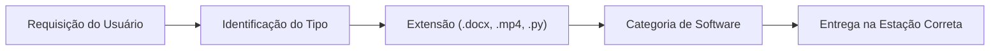

# 📦 Digital Delivery

> **Jogo multiplayer educativo de corrida e entrega de arquivos ambientado no interior de um computador.**  
> Criado para o projeto **Aquele Prof Games** como ferramenta de ensino para alunos do curso de **Operador de Computador** e entusiastas de informática.

---

## 🕹️ Sobre o Jogo

Em **Digital Delivery**, até **20 jogadores** disputam simultaneamente em uma arena 3D ambientada dentro dos componentes de uma placa-mãe de computador. Inspirado no ritmo caótico e divertido de *party royales* (como *Fall Guys*), o objetivo principal é educativo: ensinar o fluxo lógico e conceitual entre **requisições de usuários**, **tipos de arquivos**, **extensões** e os **softwares adequados** para executá-los.



---

## ✨ Funcionalidades Principais

- **Lobby Interativo em Terminal CRT Retrô**:
  - Efeito visual de fósforo verde, distorção de tubo e scanlines.
  - Animação imersiva de *power-on* e digitação com foco contínuo.
  - Tooltips contextuais de comandos educativos no canto superior da tela.
- **Puzzle de Rede e Segurança no Lobby (CTF Style)**:
  - **Host**: Cria a sala, gerencia o firewall com regras de porta (`port open 3001` / `ufw allow 3001`) e gera a assinatura criptográfica (`hash gen <chave>`).
  - **Clientes**: Conectam via simulação FTP (`connect <PIN>`), exploram pastas no sistema de arquivos virtual (`ls`, `cd security`, `cat`) e descompactam a chave com `unzip session_hash.zip` para obter o status `[PRONTO]`.
- **Modo Host / Listen Server 100% Integrado (P2P)**:
  - Não depende de servidores dedicados online para jogar. Qualquer jogador pode ser o Host da partida diretamente pela versão exportada do jogo, aceitando conexões via rede local (LAN) ou localhost.
  - Servidor dedicado Node.js / TypeScript opcional também incluso no repositório.
- **Arena 3D Competitiva**:
  - Iluminação neon digital, estética ciberespaço e obstáculos físicos.
  - Geração dinâmica de processos/cubos caindo da CPU central.
  - Estações de software com feedback visual e sonoro de entrega correta/incorreta.
  - Multiplicador de pontuação por sequência (*streak*).
  - Eventos de perigo (*hazards*): pop-ups de adware invasivos na tela e antivírus.

---

## 🛠️ Tecnologias Utilizadas

| Componente | Tecnologia / Ferramenta | Detalhes |
|---|---|---|
| **Engine Gráfica** | [Godot Engine 4.x](https://godotengine.org/) | Renderizador Forward+, GDScript, Shaders personalizados |
| **Modelos 3D & Arte** | Blender / GLTF / PBR Textures | Personagens, CPU, estações de aplicativos e tiles |
| **Listen Server Local** | GDScript (`TCPServer` / `WebSocketPeer`) | Física autoritativa, replicação a 20 TPS sem dependências externas |
| **Servidor Dedicado (Opcional)** | Node.js, TypeScript, Docker | Arquitetura modular com suporte a múltiplas salas e WebSocket nativo |

---

## 💻 Comandos do Terminal

Ao iniciar o jogo, você é recebido pelo terminal operacional. Abaixo estão os comandos disponíveis:

### Comandos Gerais
- `help` / `man`: Exibe a lista completa de comandos e manual de operação.
- `scan`: Varre e lista salas ativas no host/rede.
- `clear` / `cls`: Limpa as linhas do console.
- `exit` / `quit`: Fecha o sistema.

### Gerenciamento de Salas (Host)
- `host [modo]`: Cria uma nova sala de partida (ex: `host casual`, `host border`, `host challenge`).
- `port open 3001` ou `ufw allow 3001`: Libera a porta de conexão no firewall da sala.
- `hash gen <palavra>`: Gera a chave hash SHA-256 e disponibiliza o arquivo `session_hash.zip`.
- `status`: Exibe a segurança da sala, portas e a lista de operadores prontos/pendentes.
- `start tunnel`: Inicia o túnel de processos e transporta os operadores para a arena 3D (exige que todos estejam prontos).

### Navegação e Exploração (Clientes & Conexão)
- `connect <PIN>`: Inicia o aperto de mão FTP e conecta ao nó da sala especificada.
- `ls` / `dir`: Lista pastas e arquivos do sistema virtual da sala.
- `cd <pasta>`: Navega entre diretórios (ex: `cd security`, `cd ..`, `cd /`).
- `pwd`: Exibe o caminho do diretório virtual atual.
- `cat <arquivo>`: Lê o conteúdo de arquivos de texto (ex: `cat readme.txt`).
- `unzip session_hash.zip`: Extrai e valida a assinatura hash para marcar o operador como `[PRONTO]`.
- `leave`: Desconecta da sala atual e retorna ao terminal principal.

---

## 🚀 Como Executar o Projeto

### Pré-requisitos
- [Godot Engine 4.3+](https://godotengine.org/download) (versão padrão ou .NET)
- *(Opcional para o servidor standalone)* [Node.js 18+](https://nodejs.org/)

### 1. Executando o Cliente (Jogo)
1. Clone este repositório:
   ```bash
   git clone https://github.com/Germano123/aqueleprof-digital-delivery.git
   cd aqueleprof-digital-delivery
   ```
2. Abra a pasta `client` no Godot Engine.
3. Pressione **F5** para iniciar o projeto a partir da cena inicial (`res://scenes/terminal/terminal_login.tscn`).
4. Para criar uma partida, digite `host casual` no terminal.
5. Libere o firewall com `port open 3001`, configure a chave com `hash gen alpha` e inicie com `start tunnel`!

### 2. Executando o Servidor Standalone Node.js (Opcional)
Caso queira rodar um servidor dedicado centralizado:
```bash
cd server
npm install
npm run build
npm start
```
Ou com Docker:
```bash
cd server
docker compose up -d
```

---

## 📁 Estrutura de Pastas

```text
aqueleprof-digital-delivery/
├── GDD.md                  # Game Design Document completo
├── README.md               # Apresentação do projeto e manual
├── CHANGELOG.md            # Histórico de alterações e releases
├── .gitignore              # Regras de exclusão do Git
├── client/                 # Projeto completo na Godot Engine 4
│   ├── models/             # Modelos 3D (.glb, texturas PBR, normais, emissões)
│   ├── scenes/             # Cenas (.tscn): Terminal, Arena 3D, HUD, etc.
│   ├── scripts/            # Scripts GDScript (.gd)
│   │   ├── autoload/       # Singletons (NetworkManager, GameManager, KnowledgeBase)
│   │   ├── server/         # Listen Server local embutido (LocalServerHost, LocalRoom)
│   │   ├── terminal/       # Interface do Terminal CRT e simulações
│   │   ├── player/         # Controlador de movimentação e física do jogador
│   │   ├── entities/       # Cubos de arquivo, estações e barreiras
│   │   └── ui/             # Elementos de interface, HUD e pop-ups
│   ├── shaders/            # Shaders visuais (CRT, scanlines, brilho)
│   └── project.godot       # Configurações do projeto Godot
└── server/                 # Servidor dedicado opcional em TypeScript
    ├── src/                # Código fonte (core, auth, systems, domain)
    ├── package.json        # Dependências do backend
    └── Dockerfile          # Imagem de container para deploy
```

---

## 📄 Licença

Este projeto é desenvolvido com fins educacionais como parte das iniciativas de aprendizagem de computação e informática do **Aquele Prof Games**.
